<div align="center">

# 🦴 Bone Age from Hand X-Rays

### Sex-conditioned EfficientNetV2-S regression for pediatric bone age assessment on the RSNA dataset

*Author: **Azizul Abedin Azmi***

[](https://www.python.org/)
[](https://pytorch.org/)
[](https://github.com/huggingface/pytorch-image-models)
[](https://www.kaggle.com/datasets/kmader/rsna-bone-age)
[](#54-laptop-rtx-4060-vs-kaggle-tesla-t4)
[](LICENSE)
[](LICENSE-docs)
[](#16-portfolio-project-and-disclaimer)
[](https://orcid.org/0009-0003-5269-6900)

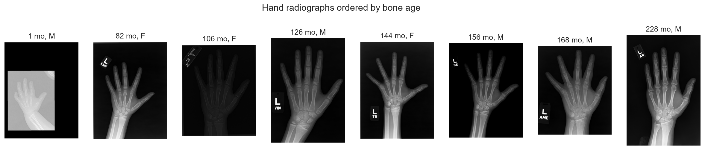

<sub>Hand radiographs ordered by bone age, from infancy to late adolescence. The growth plates close and the wrist bones appear and grow.</sub>

</div>

---

## Abstract

When a child grows unusually fast or slowly, doctors X-ray the left hand and compare the bones with an atlas to read
the **bone age**. A large gap between bone age and real age can point to hormone problems, early or late puberty, or a
growth disorder. Reading the atlas by hand is slow, and radiologists often disagree by several months.

This project trains a **regression CNN** on the [RSNA Pediatric Bone Age](https://www.kaggle.com/datasets/kmader/rsna-bone-age)
dataset (12,611 labelled hand X-rays). From one radiograph plus the child's **sex**, it predicts bone age in months. Each
X-ray is **padded to a square** before resizing so the hand keeps its real proportions, inverted scans are fixed, and
contrast is evened out with **CLAHE**. An ImageNet-21k **EfficientNetV2-S** reads the 512 × 512 image, and a learned
sex embedding joins the image features before the regression head. The model is trained with an **L1 loss on the
standardised target**, AdamW, cosine decay, mixed precision and an **EMA** of the weights. It is scored with flip TTA
on a stratified **1,425-image hold-out set** that is never used for training or model selection.

One model (fold 0, 20 epochs) reaches a hold-out **MAE of 6.11 months** (5.96 for boys,
6.28 for girls), **82% lower** than always predicting the mean bone age
(33.34 months), with R² = 0.960. That is inside the 4.8–7.0-month range reported for individual
radiologists, though not at the RSNA winner's 4.2 months. The same notebook was run on a **laptop RTX 4060** and a
**Kaggle Tesla T4** with the same split and seed: the laptop trained **1.4× faster**
(61 vs. 83 min), and the two models' accuracy differs by less
than the noise (6.11 vs. 6.19 months).

<div align="center">

<!-- AUTO:HEADLINE:START -->
| Hold-out MAE ↓ | Boys | Girls | vs. mean baseline | Within ±12 mo | R² | Training time (20 epochs) |
|:---:|:---:|:---:|:---:|:---:|:---:|:---:|
| **6.11 mo** (RTX 4060)<br>6.19 mo (Kaggle T4) | 5.96<br>6.07 | 6.28<br>6.33 | **−82%** | 88%<br>87% | 0.960<br>0.959 | **61 min** (RTX 4060)<br>83 min (Kaggle T4) |
<!-- AUTO:HEADLINE:END -->

</div>

> [!NOTE]
> **Personal portfolio project.** Built for learning and to show my work. Not affiliated with or endorsed by RSNA or
> Kaggle, and **not a medical device**. See [Portfolio project and disclaimer](#16-portfolio-project-and-disclaimer).

## Table of contents

1. [Introduction](#1-introduction)
2. [Dataset](#2-dataset)
3. [Method](#3-method)
4. [Experimental setup](#4-experimental-setup)
5. [Results](#5-results)
6. [Qualitative analysis](#6-qualitative-analysis)
7. [Discussion](#7-discussion)
8. [Pitfalls and how the notebook handles them](#8-pitfalls-and-how-the-notebook-handles-them)
9. [Reproducing the results](#9-reproducing-the-results)
10. [Comparing two GPUs yourself](#10-comparing-two-gpus-yourself)
11. [Configuration](#11-configuration)
12. [Project structure](#12-project-structure)
13. [Limitations and future work](#13-limitations-and-future-work)
14. [Citation](#14-citation)
15. [License](#15-license)
16. [Portfolio project and disclaimer](#16-portfolio-project-and-disclaimer)

---

## 1. Introduction

**Problem.** Given a left-hand radiograph $x$ and the child's sex $s \in \{0, 1\}$, predict bone age $y$ in months.
This is a **regression** task scored by the mean absolute error in months:

$$\mathrm{MAE} = \frac{1}{N}\sum_{i=1}^{N} \left| \hat{y}_i - y_i \right|$$

**Why it is hard.**
- **Sex matters.** Girls mature earlier, so the same X-ray can mean a different bone age for a boy and for a girl.
  A model without the sex input has to guess.
- **The signal is small.** Bone age is read from the width of growth plates and the shape of small wrist bones, and
  these change by fractions of a millimetre per year.
- **The images are messy.** Sizes range up to 2080 × 1600 px, aspect ratios vary, some scans are inverted, and
  exposure differs a lot between machines and scanned films.
- **The extremes are rare.** There are few infants and late teenagers, and those are also the hardest cases for
  radiologists.

**Contributions of this notebook.**
- Aspect-preserving **pad-to-square** preprocessing with automatic polarity fixing and CLAHE, cached once.
- A **sex-conditioned EfficientNetV2-S** regressor with L1 loss, EMA and flip TTA.
- An honest protocol: a stratified **hold-out set** that is never touched during training, two **image-free
  baselines**, and results per sex and per age band.
- **Grad-CAM** maps showing which bones the model uses.
- A **run record** for every run (hardware, software, timings, scores) and an automatic **laptop vs. Kaggle GPU
  comparison** that writes its tables into this README.
- Windows-safe DataLoader workers and a **GPU preflight** that lowers the batch size by itself on 8 GB cards.

## 2. Dataset

[RSNA Pediatric Bone Age](https://www.kaggle.com/datasets/kmader/rsna-bone-age): the Kaggle mirror of the 2017 RSNA
Pediatric Bone Age Machine Learning Challenge.

| Property | Value |
|---|---|
| Labelled training images | **12,611** left-hand radiographs (PNG, mixed sizes up to 2080 × 1600 px) |
| Labels | `id`, `boneage` in months (from clinical reports reviewed by pediatric radiologists), `male` (True/False) |
| Kaggle test images | 200 cases with sex but no public labels |
| Original challenge | additional 1,425-image validation set and a 200-image test set with a multi-reader reference |

<p align="center">
  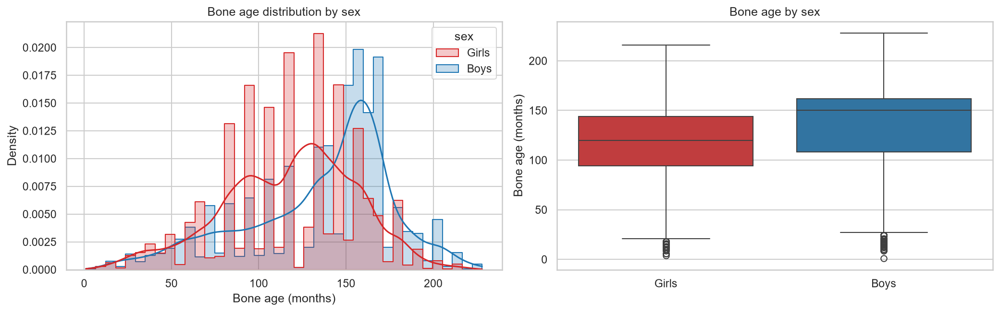
</p>
<p align="center"><sub><b>Figure 1.</b> Bone age distribution for boys and girls (histogram + KDE, and box plot). Girls' distribution sits lower, as expected.</sub></p>

<p align="center">
  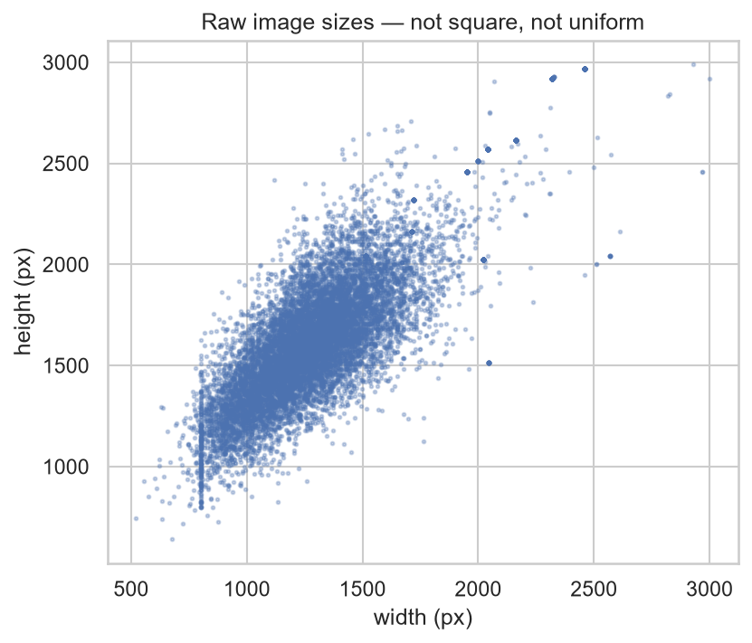
</p>
<p align="center"><sub><b>Figure 2.</b> Raw image sizes. Neither square nor uniform, which is why pad-to-square matters.</sub></p>

## 3. Method

### 3.1 Pipeline

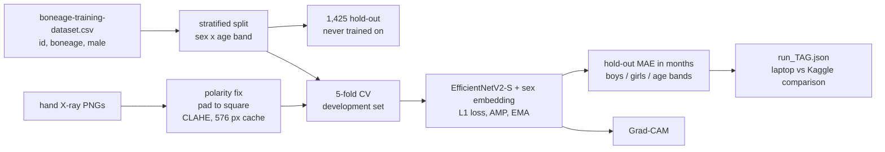

### 3.2 Preprocessing

| Step | Why |
|---|---|
| **Polarity fix**: invert scans with a bright background | a few radiographs are stored as negatives |
| **Pad to square, then resize** (`INTER_AREA`) | a direct square resize stretches or squashes the hand and distorts bone proportions |
| **CLAHE** (clip 2.0, 8 × 8 tiles) | evens out contrast between X-ray machines and scanned films |
| **Cache at 576 px** (PNG) | one-off cost; every later epoch reads small files |

<p align="center">
  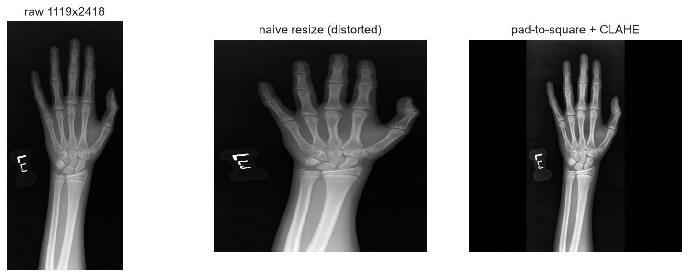
</p>
<p align="center"><sub><b>Figure 3.</b> The most elongated X-ray in the dataset: raw, squashed by a naive square resize, and padded to a square with CLAHE.</sub></p>

### 3.3 Augmentation

Small, realistic changes during training only: affine transform (rotation ±20°, shift ±6%, scale 0.85–1.15,
shear ±5°), horizontal flip, brightness/contrast ±20%, gamma 0.8–1.2.

<p align="center">
  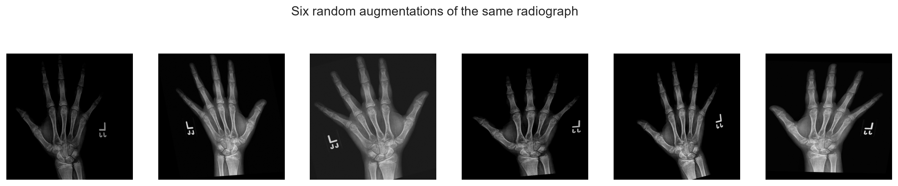
</p>
<p align="center"><sub><b>Figure 4.</b> Six random augmentations of the same radiograph.</sub></p>

### 3.4 Model

```
X-ray (1×512×512) ─► EfficientNetV2-S (ImageNet-21k, in_chans=1) ─► 1280 features ─┐
                                                                                   ├─► concat ─► Linear(1312→512) ─► SiLU ─► Dropout 0.2 ─► Linear(512→1)
sex (0/1) ─────────► Linear(1→32) + SiLU ──────────────────────────► 32 features ──┘
```

- `timm.create_model("tf_efficientnetv2_s.in21k_ft_in1k", in_chans=1, num_classes=0)`. timm folds the pretrained RGB
  filters into one grey channel. About **21 M parameters**.
- The backbone is any timm model, so the classic **ResNet-50** (`resnet50.tv2_in1k`, the same weights as torchvision
  `IMAGENET1K_V2`) or **ConvNeXt** is a one-line change.

### 3.5 Training

| Setting | Value |
|---|---|
| Target | $\tilde{y} = (y - \mu)/\sigma$ with $\mu, \sigma$ from the development set only; predictions converted back to months |
| Loss | L1 (the metric itself; robust to the odd mislabelled X-ray) |
| Optimiser | AdamW, weight decay 0.01; backbone LR 2e-4, head LR 1e-3 |
| Schedule | 1 epoch linear warm-up, then cosine decay, per step |
| Epochs / batch / size | 20 / 16 (auto-reduced if it does not fit) / 512 × 512 |
| Speed & stability | fp16 mixed precision, plain NCHW layout (`channels_last` was ~5× slower on the RTX 4060), gradient clipping at 2.0 |
| Weight averaging | EMA, decay 0.998; the EMA model is validated and saved |
| Inference | horizontal-flip TTA, mean over fold models |

### 3.6 Evaluation protocol

1. **Hold-out set:** 1,425 images (the size of the official validation set), stratified by sex × 24-month age band.
   It is never used for training, early stopping or any choice of settings. An `assert` checks there is no overlap.
2. **5-fold stratified CV** on the remaining development images. Each fold keeps its best EMA checkpoint.
3. **Baselines:** always predict the mean bone age, and predict the mean bone age for the child's sex.
4. **Metrics:** MAE (overall, boys, girls, per age band), RMSE, R², bias, Bland–Altman limits, and the share of
   predictions within ±6 and ±12 months.

## 4. Experimental setup

| | Local run | Kaggle run |
|---|---|---|
| Hardware | NVIDIA **RTX 4060 Laptop GPU** (8 GB), 16 CPU threads, 15.7 GB RAM | **Tesla T4** (16 GB; T4 x2, one card used), 4 CPU threads, 31 GB RAM |
| Software | Windows 11, Python 3.12.9, torch 2.11.0+cu128, cuDNN 9.19, timm 1.0.31 | Linux, Python 3.13, torch 2.11.0+cu130, cuDNN 9.27, timm 1.0.30 |
| Data source | `Notebook/data/rsna-bone-age/` | dataset mounted under `/kaggle/input/datasets/kmader/rsna-bone-age` |
| Image cache | `Notebook/work/cache/` (reused from an earlier run) | `/tmp/boneage_cache` (built during the run, 5 min) |
| Notebook with outputs | `Notebook/bone-age-rsna-azmi-local-geforce-rtx-4060-laptop-gpu.ipynb` | `Notebook/bone-age-rsna-azmi-kaggle.ipynb` |
| Code, split, seed, settings | identical: seed 42, 512 px, batch 16, 20 epochs, fold 0 | identical |

The software versions, CPU threads, peak GPU memory and the time of every stage are measured during each run, and
the comparison table in [section 5.4](#54-laptop-rtx-4060-vs-kaggle-tesla-t4) is generated from those measurements.

## 5. Results

> All numbers come from the two run records in [`results/runs/`](results/runs/): one run on my laptop RTX 4060 and
> one on a Kaggle Tesla T4, with identical code, split, seed and settings. Unless a table says otherwise, figures
> are from the RTX 4060 run; the Kaggle run's figures are in [`assets/kaggle-t4/`](assets/kaggle-t4/).

### 5.1 Main result: hold-out set (n = 1,425, flip TTA)

<!-- AUTO:RESULTS:START -->
| Model | RTX 4060: MAE | Boys | Girls | Kaggle T4: MAE | Boys | Girls | vs. mean baseline |
|---|---:|---:|---:|---:|---:|---:|---:|
| Mean predictor (no image) | 33.34 | 35.92 | 30.30 | 33.34 | 35.92 | 30.30 | — |
| Sex-specific mean (no image) | 32.00 | 33.57 | 30.14 | 32.00 | 33.57 | 30.14 | −4% |
| EfficientNetV2-S + sex, fold 0, flip TTA | **6.11** | 5.96 | 6.28 | **6.19** | 6.07 | 6.33 | −82% |

| Metric (CNN) | RTX 4060 | Kaggle T4 |
|---|---:|---:|
| RMSE (months) | 8.20 | 8.32 |
| R² | 0.960 | 0.959 |
| Bias, predicted − true (months) | -0.05 | -0.15 |
| Within ±6 months | 59.9% | 59.3% |
| Within ±12 months | 87.6% | 87.1% |
| Validation MAE of the kept epoch (fold 0) | 6.24 (epoch 15) | 6.23 (epoch 11) |

<sub>Hold-out n = 1,425. Sources: [`run_local-geforce-rtx-4060-laptop-gpu.json`](results/runs/run_local-geforce-rtx-4060-laptop-gpu.json), [`run_kaggle-tesla-t4.json`](results/runs/run_kaggle-tesla-t4.json).</sub>

- The image carries almost all of the information: the sex-specific mean only improves on the plain mean by
  4%, while the CNN removes 82% of the error.
- The model is almost unbiased (-0.05 months on average), and boys are predicted slightly better than girls in both runs.
<!-- AUTO:RESULTS:END -->

**Reference points from the literature** (different test set, so not directly comparable):

| System | MAE (months) | Evaluation set |
|---|---:|---|
| RSNA 2017 challenge winner | 4.2 | official 200-case test set, multi-reader reference |
| Individual radiologists | 4.8 – 7.0 | against the reference panel (Halabi et al., 2019) |

<p align="center">
  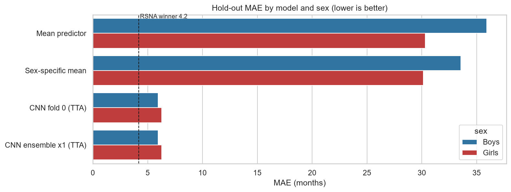
</p>
<p align="center"><sub><b>Figure 5.</b> Hold-out MAE by model and sex. The dashed line is the RSNA 2017 winner (4.2 months).</sub></p>

### 5.2 Error by age band

<!-- AUTO:BANDS:START -->
| Bone age | Boys: RTX 4060 | Boys: T4 | n | Girls: RTX 4060 | Girls: T4 | n |
|---|---:|---:|---:|---:|---:|---:|
| 0–24 mo | 7.41 | 6.76 | 11 | 5.48 | 5.51 | 8 |
| 24–48 mo | 6.09 | 6.56 | 24 | 5.14 | 5.62 | 22 |
| 48–72 mo | 6.33 | 6.42 | 60 | 6.19 | 6.04 | 55 |
| 72–96 mo | 8.39 | 8.71 | 66 | 6.96 | 7.01 | 122 |
| 96–120 mo | 8.39 | 7.83 | 88 | 7.24 | 7.39 | 141 |
| 120–144 mo | 7.55 | 7.62 | 120 | 5.49 | 5.49 | 167 |
| 144–168 mo | 4.25 | 4.41 | 306 | 6.00 | 5.94 | 99 |
| 168–192 mo | 5.06 | 5.67 | 63 | 5.03 | 5.36 | 34 |
| 192–240 mo | 5.18 | 5.42 | 34 | 10.05 | 9.43 | 5 |

- **Mid-childhood is the hardest range here**, not the extremes: boys aged 72–120 months have the highest error
  (≈ 8.4 months), while boys at 144–168 months, the largest group, are predicted best (≈ 4.3 months).
- Girls above 192 months show a high error, but there are only 5 of them, so that number is not reliable.
- Both runs show the same pattern band by band, so it comes from the data and the model, not from the GPU.
<!-- AUTO:BANDS:END -->

### 5.3 Training dynamics

<p align="center">
  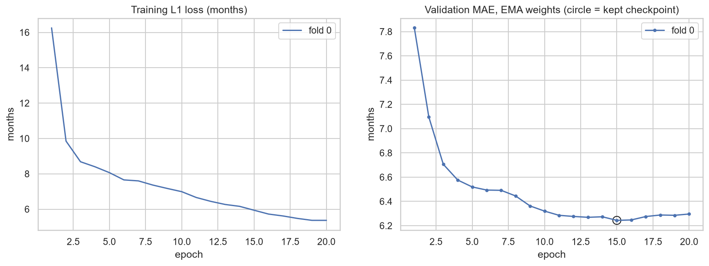
</p>
<p align="center"><sub><b>Figure 6.</b> Training loss and validation MAE (EMA weights) per epoch. The circle marks the checkpoint that was kept. Per-epoch numbers: <a href="results/local-rtx-4060-laptop/history.csv">RTX 4060</a>, <a href="results/kaggle-tesla-t4/history.csv">Kaggle T4</a>. The Kaggle run's curves are in <a href="assets/kaggle-t4/training_curves.png"><code>assets/kaggle-t4/</code></a>.</sub></p>

Validation MAE drops fast in the first 5 epochs, then flattens around 6.2–6.3 months from epoch ~10. The kept
checkpoint was epoch 15 on the RTX 4060 and epoch 11 on the T4; both are within 0.01 months of each other, so 12–15
epochs would give the same result in less time.

### 5.4 Laptop RTX 4060 vs. Kaggle Tesla T4

The same notebook, split and seed were run on both machines. Both runs score the **same** hold-out images, so beyond
speed I can check whether two GPUs give the same answers, image by image.

<!-- AUTO:HARDWARE:START -->
| | **Laptop: RTX 4060** | **Kaggle: Tesla T4** |
|---|---:|---:|
| GPU / VRAM | RTX 4060 Laptop GPU / 8 GB | Tesla T4 / 16 GB (T4 x2, one used) |
| CPU threads / RAM | 16 / 15.7 GB | 4 / 31.3 GB |
| OS, Python | Windows 11, 3.12.9 | Linux, 3.13.16 |
| torch / CUDA / cuDNN | 2.11.0+cu128 / 12.8 / 91900 | 2.11.0+cu130 / 13.0 / 92700 |
| Batch size / peak GPU memory | 16 / 6.48 GB | 16 / 6.48 GB |
| **Training throughput** | **56 img/s** | 39 img/s |
| Seconds per epoch (train + validation) | **166 + 16** | 229 + 20 |
| **Training, 20 epochs** | **60.6 min** | 83.0 min |
| Hold-out inference with TTA | 49 img/s | **109 img/s** |
| Image cache | reused (1 s) | built (5.0 min) |
| Whole notebook | 65 min | 106 min |
| **Hold-out MAE** (boys / girls) | **6.11** (5.96 / 6.28) | 6.19 (6.07 / 6.33) |
| Kept epoch | 15 | 11 |

**What the comparison shows**
- **Speed:** the laptop GPU trained **1.44× faster** than the T4
  (61 vs. 83 min). The RTX 4060 (Ada, 2023) has newer and faster fp16 tensor cores
  than the T4 (Turing, 2018), and the laptop has 16 CPU threads for data loading versus 4 on Kaggle.
- **Inference was faster on Kaggle** (109 vs. 49 img/s). The hold-out pass is
  short, and on Windows each new DataLoader has to start its worker processes, which costs several seconds.
- **Whole-notebook time is not a fair comparison:** the laptop reused an image cache from an earlier run, while
  Kaggle built it during the run (5 min). Training time is the fair number.
- **Accuracy is the same within noise:** the T4 model's MAE is 0.08 months higher, with a 95% confidence
  interval of ±0.10 for the paired difference over the same 1,425 images. Predictions agree with r =
  0.9985 and differ by 1.64 months on average (median 1.26). The differences come from
  different cuDNN kernels and CUDA versions, which change floating-point rounding during training.
- **Memory:** both used 6.5 GB at batch 16, so 512 px training fits on an 8 GB laptop GPU.
- Averaging the two models' predictions (a free 2-model ensemble) gives **6.08 months**.

<sub>Sources: [`results/runs/`](results/runs/). Generated from both run records.</sub>
<!-- AUTO:HARDWARE:END -->

<p align="center">
  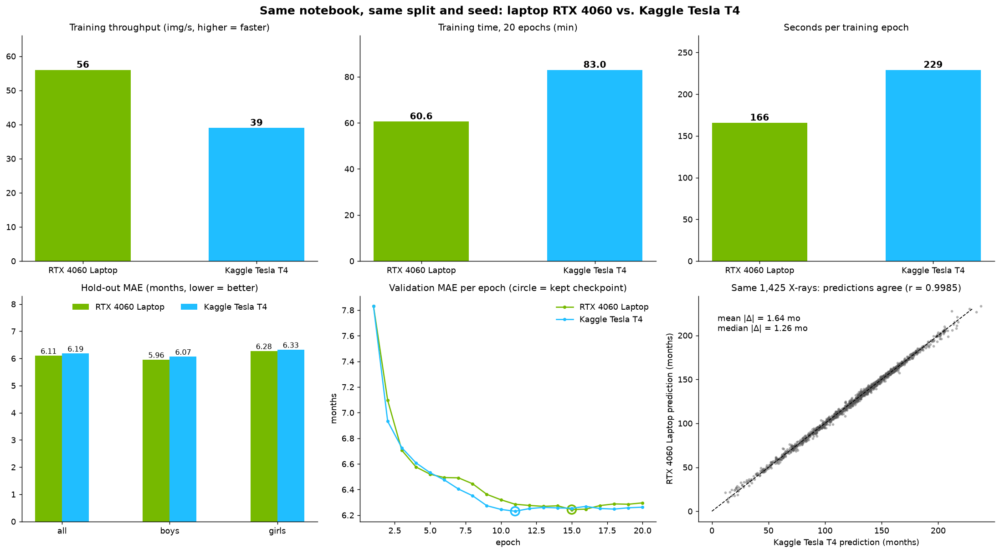
</p>
<p align="center"><sub><b>Figure 7.</b> Laptop RTX 4060 vs. Kaggle Tesla T4: training throughput, training time, seconds per epoch, hold-out MAE by sex, validation MAE per epoch, and the two runs' predictions on the same 1,425 X-rays.</sub></p>

## 6. Qualitative analysis

### 6.1 Where the errors are

<p align="center">
  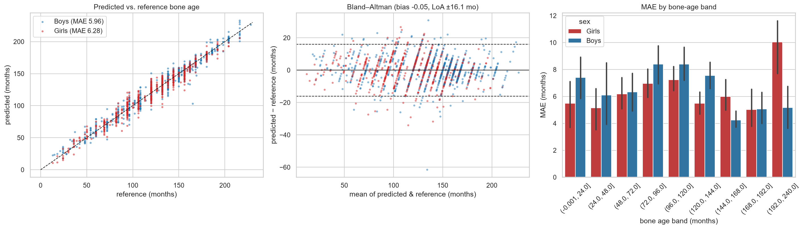
</p>
<p align="center"><sub><b>Figure 8.</b> Predicted vs. reference bone age (left), Bland–Altman agreement with bias and 95% limits (middle), and MAE per age band for boys and girls (right).</sub></p>

### 6.2 What the model looks at (Grad-CAM)

<p align="center">
  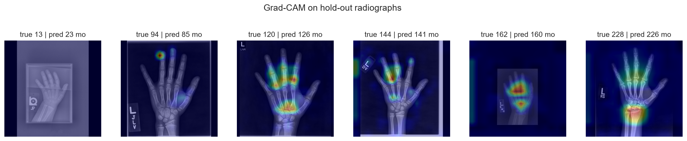
</p>
<p align="center"><sub><b>Figure 9.</b> Grad-CAM on six hold-out X-rays from young to old. Heat on the finger growth plates and the wrist bones is what a radiologist would look at; heat on labels or rulers would be a shortcut.</sub></p>

## 7. Discussion

- **The sex input and pad-to-square preprocessing** are the two cheapest wins. Without sex the model has to guess
  which standard applies, and without padding it has to learn around a systematic distortion.
- **L1 instead of MSE** optimises exactly what is reported and is less pulled around by noisy labels, which come from
  single clinical reports.
- **Error depends on age more than on sex.** Mid-childhood (72–120 months) is the hardest range in this hold-out
  set, while the largest group, boys aged 12–14 years, is predicted best. Per-band MAE is the honest view; the
  overall MAE hides it.
- **More data at the edges would help most.** Fewer than 20 children per sex are younger than 2 years, and only 5
  girls are older than 16, so those bands are both hard to learn and too small to measure reliably.
- **Hardware should change speed, not accuracy.** With the same split and seed, small differences between the two GPU
  runs come from non-deterministic cuDNN kernels and data-loader ordering. Section 5.4 confirms this: the
  laptop and Kaggle models differ by 0.08 ± 0.10 months in MAE, which is not significant.

## 8. Pitfalls and how the notebook handles them

<details open>
<summary><b>1. DataLoader workers fail on Windows</b></summary>

- **Cause:** Windows *spawns* worker processes, and a spawned worker can only import classes from a real file, not
  from a notebook cell.
- **Fix:** the preprocessing function and the `Dataset` are written to `boneage_lib.py` by a `%%writefile` cell and
  imported from there. Windows uses 4 workers.
</details>

<details>
<summary><b>2. "Dataset not found" although it is attached or downloaded</b></summary>

- **Cause:** the dataset sits in a different place on every machine: `/kaggle/input/...` on Kaggle, a nested folder
  after unzipping locally, sometimes behind a symlink. An earlier version only checked a few fixed patterns.
- **Fix:** the notebook walks every sub-folder of all likely locations (following symlinks) looking for
  `boneage-training-dataset.csv`. It prints where it found the data, or lists every folder it searched. Only then
  does a separate cell download the dataset.
</details>

<details>
<summary><b>3. Out of memory on an 8 GB laptop GPU</b></summary>

- **Fix:** a **GPU preflight** runs one real training step at full size before training. It reports the peak memory
  and halves `BATCH_SIZE` until the step fits, so the run doesn't crash an hour in. The batch that was actually used
  is saved in the run record.
</details>

<details>
<summary><b>4. <code>IndexError: list index out of range</code> in a DataLoader worker after reinstalling PyTorch</b></summary>

- **Cause:** I replaced the CPU-only PyTorch with the CUDA build while the VS Code kernel was still running. The
  kernel kept the old version in memory, but on Windows every DataLoader worker is a fresh process that loaded the
  new version from disk, and the two disagreed.
- **Fix:** restart the kernel after any `pip install`. The first cell now compares the loaded and installed torch
  versions and stops with "Restart the kernel" if they differ.
</details>

<details>
<summary><b>5. Training was 5× slower than it should be (<code>channels_last</code>)</b></summary>

- **Symptom:** ~12 img/s on the RTX 4060 at 512 px, with the GPU at 100% and no power or thermal throttling.
- **Cause:** with torch 2.11 + cuDNN 9.19 on this GPU, the `channels_last` (NHWC) memory layout picks much slower
  kernels in mixed precision.

  | EfficientNetV2-S, 512 px, batch 16 | img/s |
  |---|---:|
  | `channels_last` + fp16 | 12.2 |
  | **NCHW + fp16 (used)** | **62.4** |
  | NCHW + fp32 | 1.6 |

- **Fix:** `CHANNELS_LAST = False` by default (set it to `True` to try it on other GPUs).
</details>

<details>
<summary><b>6. Hands distorted by resizing</b></summary>

- **Fix:** pad to a square first, then resize with `INTER_AREA`. Figure 3 shows the difference on the most elongated
  image in the dataset.
</details>

<details>
<summary><b>7. Inverted (negative) scans</b></summary>

- **Fix:** if the border of the image is brighter than its centre and above mid-grey, it is inverted before padding,
  so every hand is bright on a black background.
</details>

<details>
<summary><b>8. The image-caching step crashed with <code>n_jobs == 0</code></b></summary>

- **Cause:** I found this in a smoke test: with `NUM_WORKERS = 0`, joblib refuses to start.
- **Fix:** the cache uses `max(1, NUM_WORKERS)` processes.
</details>

<details>
<summary><b>9. Optimistic scores from leaking hold-out information</b></summary>

- **Fix:** the hold-out set is split off before anything else, the target mean and std come from the development set
  only, an `assert` checks there is no overlap, and early stopping uses the fold's validation split, never the hold-out.
</details>

<details>
<summary><b>10. A low MAE that means nothing</b></summary>

- **Fix:** every result is shown next to a mean predictor and a sex-specific mean predictor, so it is clear how much
  comes from the image.
</details>

## 9. Reproducing the results

### Option A: Kaggle

1. Create a new notebook → **File → Import Notebook** → upload
   [`Notebook/bone-age-rsna-azmi-kaggle.ipynb`](Notebook/bone-age-rsna-azmi-kaggle.ipynb).
2. **Add Input** → search **RSNA Bone Age** (by kmader, ≈ 10 GB). It is mounted under `/kaggle/input` (`../input`)
   and found automatically. If you forget this step, the notebook downloads the dataset with `kagglehub` instead
   (needs Internet On).
3. Settings: **Accelerator = GPU**, **Internet = On** (to download the pretrained timm weights once).
4. **Save Version → Save & Run All (Commit)**, so the run keeps going in the background and its outputs are saved.

### Option B: local GPU (RTX 4060 laptop)

```bash
python -m venv .venv
```

```bash
.venv\Scripts\activate
```

```bash
pip install torch torchvision --index-url https://download.pytorch.org/whl/cu128
```

```bash
pip install -r requirements.txt
```

> [!IMPORTANT]
> Install PyTorch from the **PyTorch index first**. On Windows, `pip install torch` from PyPI gives a **CPU-only**
> build (`torch.__version__` ends in `+cpu`), and the notebook then can't see the RTX 4060. If that happened, run
> `pip install --force-reinstall torch torchvision --index-url https://download.pytorch.org/whl/cu128` and restart the
> kernel. The notebook's first cell prints a warning when it detects this.

Open the notebook, select the `.venv` kernel and **Run All**. The notebook finds its own folder (`Notebook/`) by
itself, also in VS Code, so the working directory doesn't matter.

The notebook **looks for the dataset first** in `BONEAGE_DATA`, `/kaggle/input`, `../input`, `Notebook/data/`,
`Notebook/` and `data/` (every sub-folder, symlinks followed). It **downloads only if nothing is found**, and then
**into the notebook's own folder**, `Notebook/data/rsna-bone-age/`:

| Step | What happens |
|---|---|
| 1. Look | prints `✅ Found the dataset in …` and downloads nothing, or lists every folder it searched |
| 2. Download | the `kaggle` CLI (`kaggle datasets download -d kmader/rsna-bone-age --unzip`) into `Notebook/data/rsna-bone-age/`; if the CLI is missing or fails, `kagglehub` into the same folder |
| 3. Load | labels matched to their PNGs; rows without an image are dropped |

To download by hand instead, unzip the [Kaggle dataset](https://www.kaggle.com/datasets/kmader/rsna-bone-age) into
`Notebook/data/rsna-bone-age/`, or set `AUTO_DOWNLOAD = False` to stop the notebook from downloading.
Outputs go to `Notebook/work/` and figures to `assets/`.

For a quick smoke test, set an environment variable before starting Jupyter:
`BONEAGE_CFG='{"QUICK_DEBUG": true}'`.

**Single-image inference** (inside the notebook, after training):

```python
predict_bone_age("path/to/hand.png", male=True)   # -> bone age in months
```

## 10. Comparing two GPUs yourself

1. Run the notebook on Kaggle. From the finished version's **Output** tab, download `runs/run_kaggle-*.json` and
   `runs/holdout_pred_kaggle-*.csv`.
2. Put both files in [`results/runs/`](results/runs/) (or `Notebook/work/runs/`). The comparison searches both.
3. Run the notebook locally. It writes `run_local-*.json`, and its last cell fills sections 5.1, 5.2 and 5.4 of this
   README and draws `assets/hardware_comparison.png`.

If the two runs used different settings (backbone, image size, epochs, folds, batch), the notebook prints a warning,
because the timings would no longer be a like-for-like comparison.

## 11. Configuration

All settings are in the `CFG` class in section 1 of the notebook:

| Key | Default | Meaning |
|---|---|---|
| `BACKBONE` | `tf_efficientnetv2_s.in21k_ft_in1k` | any timm model; `resnet50.tv2_in1k` for the classic baseline |
| `IMG_SIZE` / `CACHE_SIZE` | `512` / `576` | network input / cached square size |
| `BATCH_SIZE` | `16` | halved automatically by the GPU preflight if it does not fit |
| `EPOCHS` / `LR` / `HEAD_LR_MULT` | `20` / `2e-4` / `5` | cosine schedule, AdamW |
| `LOSS` | `l1` | or `huber` |
| `N_FOLDS` / `TRAIN_FOLDS` | `5` / `[0]` | `[0, 1, 2, 3, 4]` trains the full ensemble (best score, 5× time) |
| `HOLDOUT_SIZE` | `1425` | images locked away for the final score |
| `TTA` | `True` | average with the mirrored image |
| `CHANNELS_LAST` | `False` | NHWC memory layout; ~5× slower on the RTX 4060, so off |
| `NUM_WORKERS` | 4 on Windows, else up to 8 | DataLoader / cache workers |
| `AUTO_DOWNLOAD` | `True` | download the dataset only if the search finds nothing (kaggle CLI, then kagglehub) |
| `RUN_TAG` | `None` | name of the run record; default `local-<gpu>` or `kaggle-<gpu>` |
| `QUICK_DEBUG` | `False` | tiny subset, 2 epochs, 256 px |

Environment variables: `BONEAGE_DATA` (data folder), `BONEAGE_WORK` (outputs), `BONEAGE_TMP` (image cache),
`BONEAGE_ASSETS` (figures), `BONEAGE_CFG` (JSON overrides). There are no secrets in the project.

## 12. Project structure

```text
Bone Age From Hand X-Rays/
├── Notebook/
│   ├── bone-age-rsna-azmi-kaggle.ipynb   # the whole pipeline, with the outputs of the Kaggle T4 run
│   ├── bone-age-rsna-azmi-local-geforce-rtx-4060-laptop-gpu.ipynb   # same code, outputs of the RTX 4060 run
│   ├── data/rsna-bone-age/               # dataset, found or downloaded here (not in the repo)
│   └── work/                             # working files of a run: cache, checkpoints (not in the repo)
├── results/
│   ├── runs/                             # one record per run: hardware, software, timings, all scores
│   │   ├── run_local-geforce-rtx-4060-laptop-gpu.json  + holdout_pred_….csv
│   │   └── run_kaggle-tesla-t4.json                    + holdout_pred_….csv
│   ├── local-rtx-4060-laptop/            # history.csv (per epoch), results_table.md, test_predictions.csv
│   └── kaggle-tesla-t4/                  # the same for the Kaggle run
├── assets/                               # figures of the RTX 4060 run + hardware_comparison.png
│   └── kaggle-t4/                        # figures of the Kaggle run that depend on the model
├── CITATION.cff                          # "Cite this repository" metadata
├── LICENSE                               # MIT, for the code and notebooks
├── LICENSE-docs                          # CC BY 4.0, for docs and figures
├── requirements.txt
└── README.md
```

The trained checkpoints (`fold0.pt`, 84 MB each) are not in the repository; every number and figure above can be
reproduced by running the notebook. `Notebook/boneage_lib.py` is written by the notebook when it runs.

## 13. Limitations and future work

**Limitations**
- The hold-out set comes from the training CSV, whose labels are single clinical reports. The official challenge test
  set used a consensus of several radiologists, so the two numbers are not directly comparable.
- The data comes from a small number of US hospitals. Performance on other populations and scanners is unknown.
- By default only one fold is trained. The 5-fold ensemble is usually better but takes about 5× longer.
- **This is a research and learning project, not a validated medical device. It must not be used for diagnosis.**

**Future work** (proposed, not implemented)
- Train all 5 folds at 640 px with EfficientNetV2-M or ConvNeXt, and mix backbone families in the ensemble.
- Hand detection and cropping before resizing; region-of-interest branches for the carpal bones and phalanges.
- Evaluate on the official RSNA validation and test sets.
- Confidence intervals for the MAE (bootstrap over the hold-out set).
- Publish the trained weights with an inference script.

## 14. Citation

If you use this work, please credit it (see [License](#15-license)). GitHub's **"Cite this repository"** button
(from [`CITATION.cff`](CITATION.cff)) gives the same citation in APA and BibTeX.

```bibtex
@misc{azmi2026boneage,
  author = {Azizul Abedin Azmi},
  title  = {Bone Age from Hand X-Rays: Sex-Conditioned EfficientNetV2 Regression on the RSNA Pediatric Bone Age Dataset},
  year   = {2026},
  howpublished = {\url{https://github.com/azizulabedinazmi/Bone-Age-From-Hand-X-Rays}},
  note   = {ORCID: 0009-0003-5269-6900. Code: MIT License; documentation and figures: CC BY 4.0}
}
```

**References**
1. Halabi SS, Prevedello LM, Kalpathy-Cramer J, et al. The RSNA Pediatric Bone Age Machine Learning Challenge. *Radiology.* 2019;290(2):498–503.
2. Larson DB, Chen MC, Lungren MP, et al. Performance of a deep-learning neural network model in assessing skeletal maturity on pediatric hand radiographs. *Radiology.* 2018;287(1):313–322.
3. Greulich WW, Pyle SI. *Radiographic Atlas of Skeletal Development of the Hand and Wrist.* 2nd ed. Stanford University Press; 1959.
4. Iglovikov VI, Rakhlin A, Kalinin AA, Shvets AA. Paediatric bone age assessment using deep convolutional neural networks. *DLMIA, MICCAI Workshops*, 2018.
5. Tan M, Le Q. EfficientNetV2: Smaller models and faster training. *ICML*, 2021.
6. Selvaraju RR, et al. Grad-CAM: Visual explanations from deep networks via gradient-based localization. *ICCV*, 2017.

## 15. License

| Part | License | What you must do |
|---|---|---|
| **Code and notebook** | [MIT](LICENSE) | Keep the copyright notice *"Copyright (c) 2026 Azizul Abedin Azmi"* and the license text in every copy |
| **Documentation and figures** | [CC BY 4.0](LICENSE-docs) | Give appropriate credit, link to the license, and indicate if changes were made |

For the documentation and figures, the credit must include the name **"Azizul Abedin Azmi"**. Example:

> "Bone Age from Hand X-Rays" by Azizul Abedin Azmi, licensed under [CC BY 4.0](https://creativecommons.org/licenses/by/4.0/). Changes were made.

**Data:** the RSNA Pediatric Bone Age data is **not** covered by either license and is not redistributed here (no
X-ray files are included). Use it under the terms shown on the [Kaggle dataset page](https://www.kaggle.com/datasets/kmader/rsna-bone-age)
and RSNA's terms. Some figures (`output.png`, `preprocessing.png`, `augmentation.png`, `gradcam.png`) show example
radiographs from the dataset for illustration only.

**Dataset acknowledgement:** RSNA Radiology Informatics Committee Pediatric Bone Age Machine Learning Challenge
Organizing Committee: Kathy Andriole (Massachusetts General Hospital), Brad Erickson (Mayo Clinic), Adam Flanders
(Thomas Jefferson University) and Safwan Halabi (Stanford University). Kaggle mirror by K. Mader.

## 16. Portfolio project and disclaimer

- **Purpose.** This is a personal portfolio and learning project by Azizul Abedin Azmi, not a commercial product or
  service.
- **No affiliation.** Not affiliated with, sponsored or endorsed by the Radiological Society of North America (RSNA),
  Kaggle, or any of the institutions that contributed data.
- **Data.** No radiographs or label files are redistributed here. The example figures are for illustration only.
- **Not for clinical use.** The model has not been clinically validated. It must not be used for diagnosis, treatment
  or any decision about a patient.
- **No warranty.** Everything here is provided "as is", without warranty of any kind (see [LICENSE](LICENSE)).
- **Takedown requests.** If you are a rights holder and want any material removed, please
  [open an issue](https://github.com/azizulabedinazmi/Bone-Age-From-Hand-X-Rays/issues) and it will be removed promptly.

---

<div align="center">
<sub>Made by <b>Azizul Abedin Azmi</b> · <a href="https://orcid.org/0009-0003-5269-6900">ORCID 0009-0003-5269-6900</a></sub>
<br>
<sub>Keywords: bone age assessment · pediatric radiology · hand X-ray · RSNA · deep learning · CNN regression · EfficientNetV2 · PyTorch · timm · Grad-CAM · Kaggle</sub>
</div>
